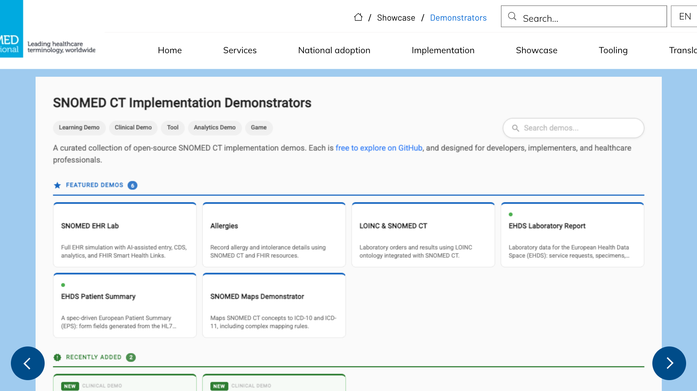
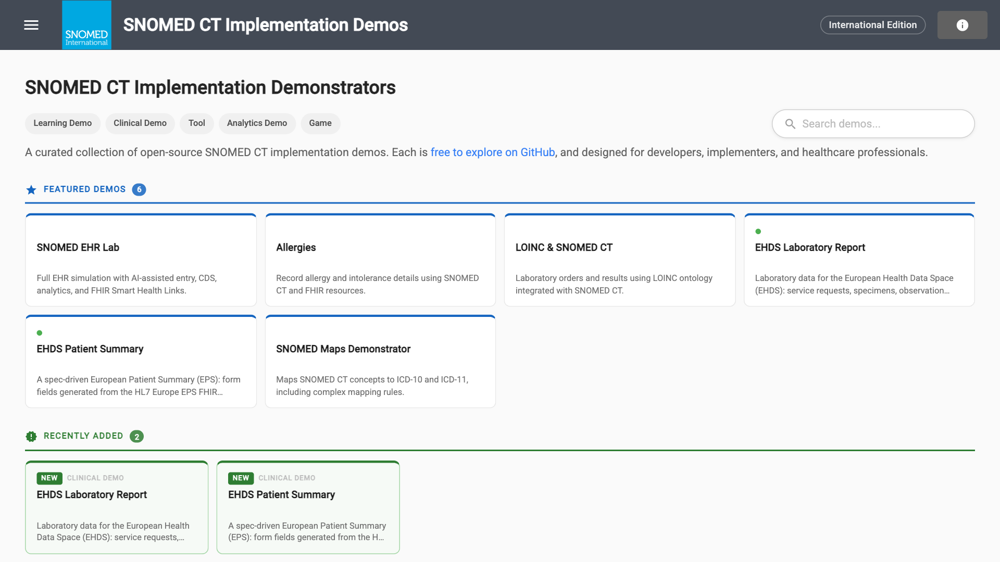
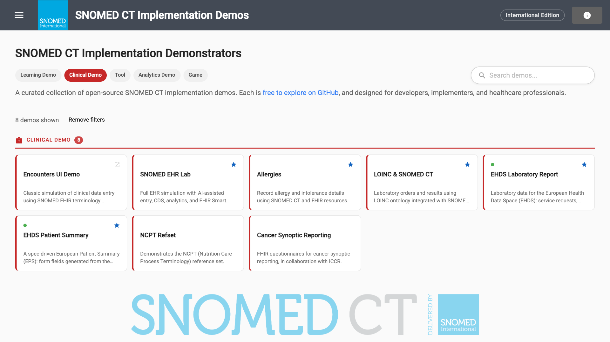
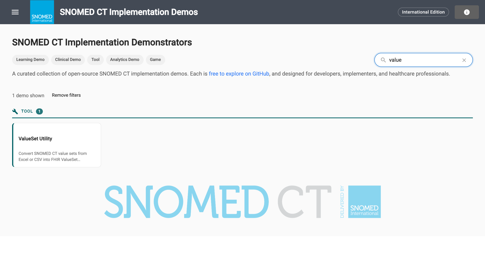
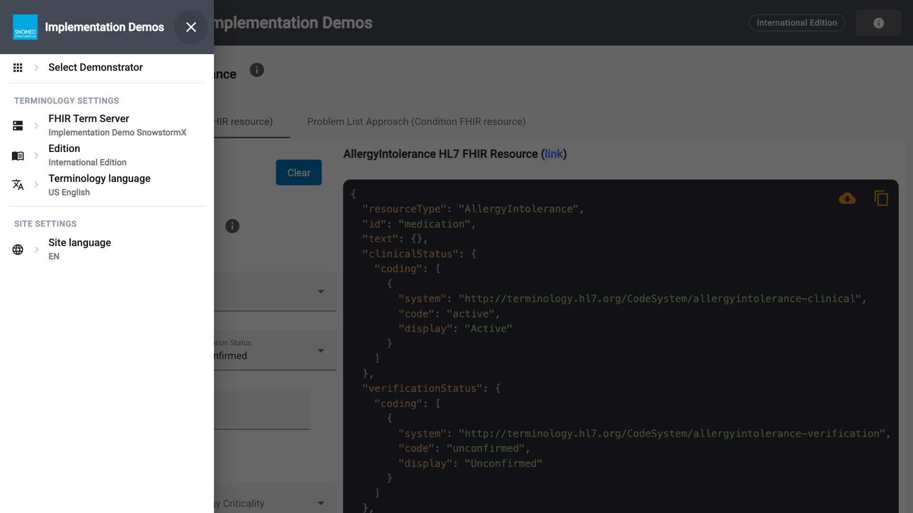

# SNOMED CT Implementation Demonstrators Guide

The **SNOMED CT Implementation Demonstrators** are a collection of small, working applications that show how **SNOMED CT** can be used in practice. Each demonstrator focuses on one implementation topic, such as terminology binding, recording allergies, cancer synoptic reporting or building FHIR ValueSets. All of them are open source, and they are designed for developers, implementers and healthcare professionals.

This guide explains how to find your way around the demonstrators site, and has a page for each demonstrator with a short video and step-by-step instructions.

**Try it here:** [https://implementation.snomed.org/showcase/demonstrators](https://implementation.snomed.org/showcase/demonstrators)

## Watch the 90-second video


A 90-second introduction to the demonstrators site: where to find it, how the catalogue is organised, filtering and searching, opening a demonstrator and changing the terminology settings.



The demonstrators are for **learning, exploring and prototyping**. They are not clinical systems. Review anything they produce, such as FHIR resources or value sets, before you use it as a model for production.


## Find the demonstrators

Open the [SNOMED International implementation site](https://implementation.snomed.org/) and select **Showcase** > **Demonstrators**. You can also open the demonstrators directly at [https://ihtsdo.github.io/sct-implementation-demonstrator](https://ihtsdo.github.io/sct-implementation-demonstrator/#/home).

<figure> Demonstrators"><figcaption>
The demonstrators on the SNOMED International implementation site.
</figcaption></figure>

The source code for every demonstrator is on GitHub: [IHTSDO/sct-implementation-demonstrator](https://github.com/IHTSDO/sct-implementation-demonstrator).

## Browse the catalogue

The catalogue starts with two highlighted groups:

* **Featured demos**: a selection of demonstrators to start with. They are also marked with a star in the lists below.
* **Recently added**: the newest demonstrators, marked **NEW**.

Below them, every demonstrator is listed by type:

| Type | What it is | Examples |
| --- | --- | --- |
| **Learning Demo** | Explains a SNOMED CT concept or technique | Terminology Bindings Sandbox, Context Representation Transformations, SNOMED Maps Demonstrator |
| **Clinical Demo** | Shows SNOMED CT in a clinical recording scenario | Allergies, Cancer Synoptic Reporting, EHDS Patient Summary |
| **Tool** | A utility you can use with your own content | ValueSet Utility, Extensions Search Utility, FHIR Resource Internationalizer |
| **Analytics Demo** | Analyses and reports on SNOMED CT coded data | Descriptive Analytics, Analytics with Snolytical |
| **Game** | Learn SNOMED CT while you play | Snoguess, Attribute Fall |

A card with the open-in-new-window icon (↗) opens a demonstrator that runs on its own site.

<figure><figcaption>
The catalogue: type filters and search at the top, then the featured and recently added demos.
</figcaption></figure>

## Filter and search

* **Filter by type.** Select a type under the page title, for example **Clinical Demo**. The list shows only that type, with the number of matching demos. Select **Remove filters** to see them all again.
* **Search.** Type in **Search demos…** to find a demonstrator by name or topic. For example, `value` finds the **ValueSet Utility**.

<figure><figcaption>
Filter the catalogue by type.
</figcaption></figure>

<figure><figcaption>
Search by name or topic.
</figcaption></figure>

## Open a demonstrator

Select a card to open the demonstrator. The top bar shows the SNOMED CT edition in use, for example **International Edition**. Each demonstrator has its own page in this guide (see [Demonstrators in this guide](#demonstrators-in-this-guide)).

## Change the terminology settings

The demonstrators look up SNOMED CT content on a FHIR terminology server. Select the menu (☰) at the top left to change:

| Setting | What it does |
| --- | --- |
| **Select Demonstrator** | Switch to another demonstrator |
| **FHIR Term Server** | The FHIR terminology server the demonstrators use, for example *Implementation Demo SnowstormX* |
| **Edition** | The SNOMED CT edition and version, for example *International Edition* or a national edition |
| **Terminology language** | The language of the SNOMED CT terms, for example *US English* |
| **Site language** | The language of the demonstrators' own screens |

<figure><figcaption>
Change the server, edition and language from the menu.
</figcaption></figure>


Some demonstrators are only available in English. When you choose another edition or language, they show *This module is currently available in English only.*


## Demonstrators in this guide

| Demonstrator | Type | What it shows |
| --- | --- | --- |
| [Terminology Binding Demonstrator](terminology-binding-demonstrator.md) | Learning Demo | Build a form and bind each question and its answers to SNOMED CT |
| [ValueSet Utility](valueset-utility.md) | Tool | Turn spreadsheets, code lists, Snap2Snomed maps and ECL results into FHIR ValueSets |
| [Context Representation Transformations](context-representation-transformations.md) | Learning Demo | Transform a situation concept into its FHIR resource representation |
| [Allergy, Hypersensitivity and Intolerance Demonstrator](allergy-demonstrator.md) | Clinical Demo | Record allergies with SNOMED CT and FHIR, as an allergy or a problem |
| [Cancer Synoptic Reporting](cancer-synoptic-reporting.md) | Clinical Demo | FHIR Questionnaires with SNOMED CT bindings for cancer pathology reports |

## Related resources

* [SNOMED CT Implementation Demonstrators](https://implementation.snomed.org/showcase/demonstrators)
* [Source code on GitHub](https://github.com/IHTSDO/sct-implementation-demonstrator)
* [SNOMED International Document Library](https://docs.snomed.org/)

_SNOMED CT Implementation Demos_\
[https://implementation.snomed.org/showcase/demonstrators](https://implementation.snomed.org/showcase/demonstrators)
