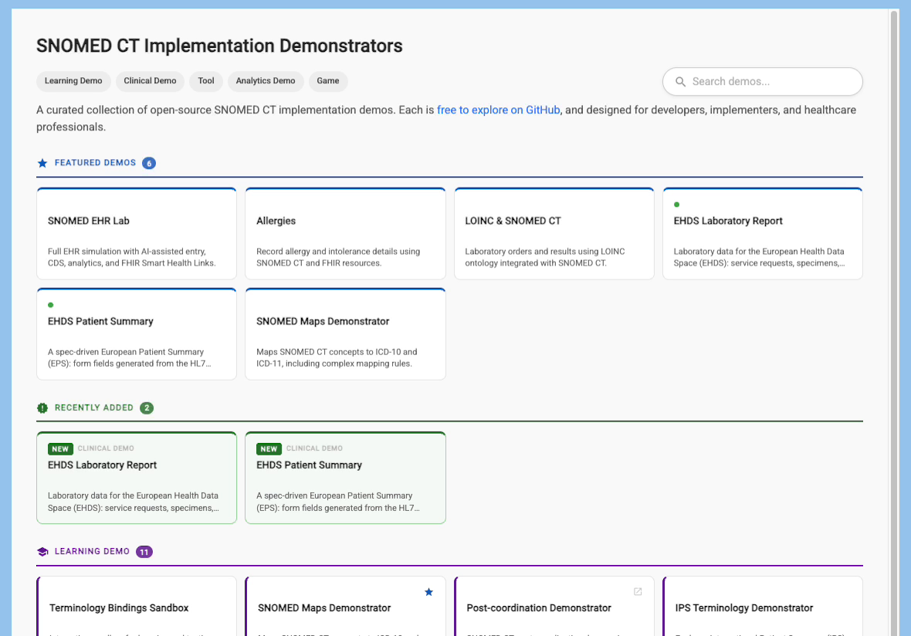
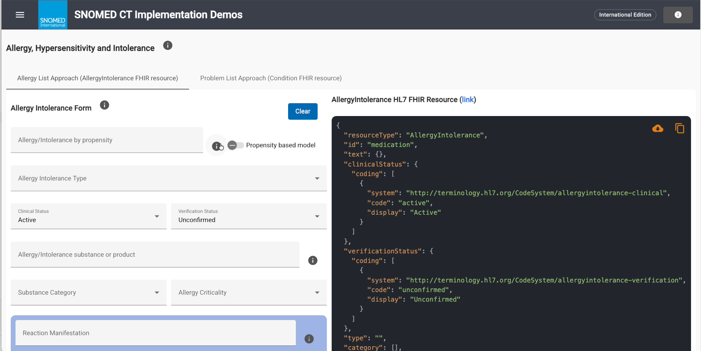
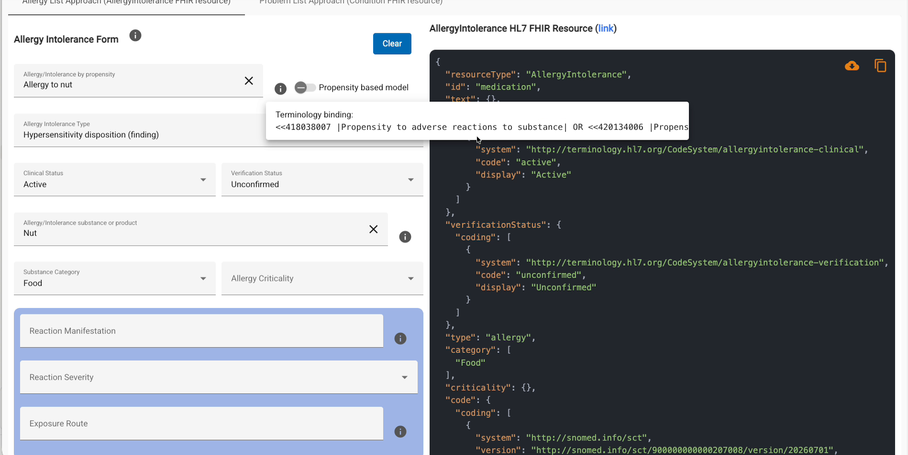
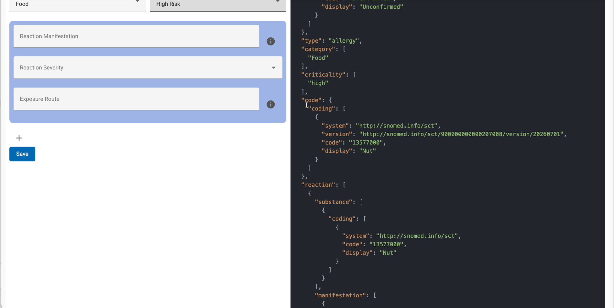
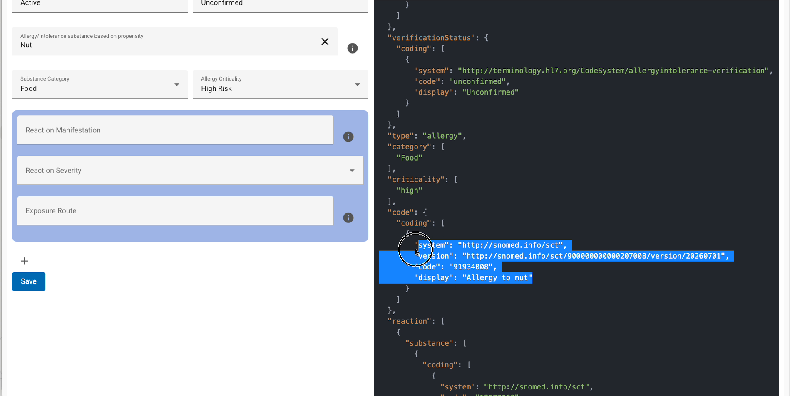
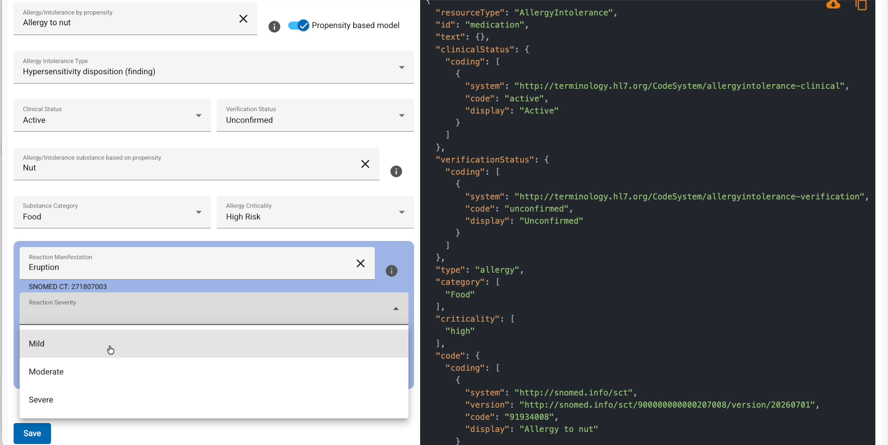
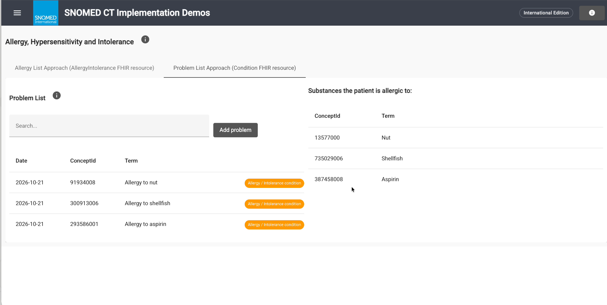
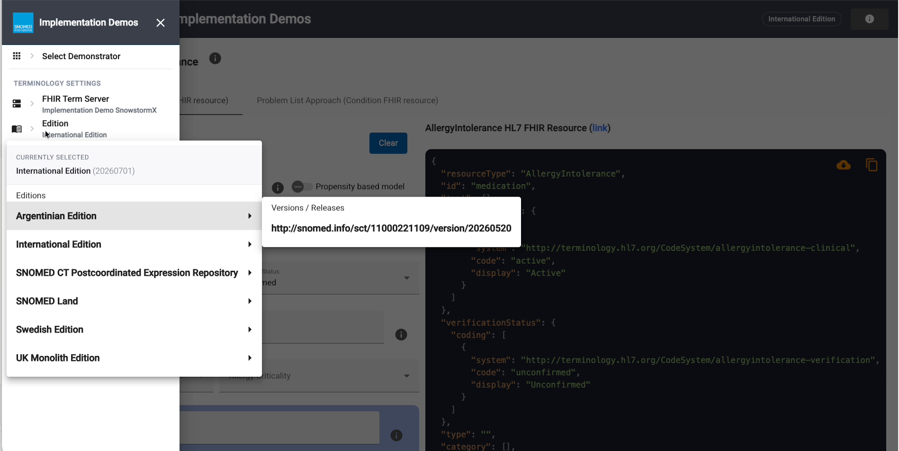

# Allergy, Hypersensitivity and Intolerance Demonstrator

The **Allergy, Hypersensitivity and Intolerance Demonstrator** shows how to record allergy and intolerance details using **SNOMED CT** and **HL7 FHIR** resources. It is one of the open-source [SNOMED CT Implementation Demonstrators](https://implementation.snomed.org/showcase/demonstrators), and it supplements the [SNOMED CT Implementation Guide for Allergy, Hypersensitivity and Intolerance](https://docs.snomed.org/implementation-guides/allergy-implementation-guide), developed by the SNOMED International Allergy Clinical Reference Group.

**Try it here:** [https://ihtsdo.github.io/sct-implementation-demonstrator/#/allergies](https://ihtsdo.github.io/sct-implementation-demonstrator/#/allergies)

## Watch the video


A short walkthrough of the demonstrator: the two recording approaches, the substance-based and propensity-based models, the FHIR resource, the problem list and decision support.



This is a **demonstrator**. Use it to explore and compare recording approaches. It is not a clinical system. Review any FHIR resources it produces before you use them as a model for production.


## What you can do

| Goal                                                    | Where in the tool                                                | What you see                                                   |
| ------------------------------------------------------- | ---------------------------------------------------------------- | -------------------------------------------------------------- |
| Record an allergy in a dedicated allergy list           | **Allergy List Approach (AllergyIntolerance FHIR resource)** tab | A live FHIR `AllergyIntolerance` resource                      |
| Compare the substance-based and propensity-based models | **Propensity based model** switch                                | Which concept goes in the resource's `code` element            |
| See which SNOMED CT content each field allows           | The **i** icon next to a field                                   | The terminology binding as an ECL expression                   |
| Record an allergy as a problem                          | **Problem List Approach (Condition FHIR resource)** tab          | The problem list and the substances the patient is allergic to |
| Work with a national edition or another language        | The menu (☰)                                                     | Search results from the selected edition and language          |

## Before you start

* **Find the tool.** Open the [SNOMED CT Implementation Demonstrators](https://implementation.snomed.org/showcase/demonstrators) page and select the **Allergies** card under **Featured demos**.
* **Check the edition.** The top bar shows the edition the tool searches, for example **International Edition**.
* **Read the guide.** The demonstrator follows the recommendations in the [Implementation Guide](https://docs.snomed.org/implementation-guides/allergy-implementation-guide). Select the **i** icon next to a form's title for a summary of the guidance for that approach.

<figure><figcaption>
Open the demonstrator from the Allergies card.
</figcaption></figure>

## Two ways to record an allergy

An electronic health record can hold allergy information in two places. The demonstrator has a tab for each:

* **Allergy List Approach (AllergyIntolerance FHIR resource):** a dedicated allergy and intolerance section of the record. Each entry is a FHIR `AllergyIntolerance` resource.
* **Problem List Approach (Condition FHIR resource):** the allergy is recorded as a problem among the patient's other problems. Each entry is a FHIR `Condition` resource.

<figure><figcaption>
The Allergy List Approach: the form on the left, the FHIR resource on the right.
</figcaption></figure>

## Choose the model: substance-based or propensity-based

On the **Allergy List Approach** tab, the **Propensity based model** switch sets which concept goes into the `code` element of the `AllergyIntolerance` resource:

| Switch | Model            | code holds                                        | Example                       |
| ------ | ---------------- | ------------------------------------------------- | ----------------------------- |
| Off    | Substance-based  | The causative **substance**                       | `13577000` \|Nut\|            |
| On     | Propensity-based | The **disorder** (propensity to adverse reaction) | `91934008` \|Allergy to nut\| |

In both models the substance is also recorded in `reaction.substance`. Choosing a model is one of the key decisions implementers need to make. The [Implementation Guide](https://docs.snomed.org/implementation-guides/allergy-implementation-guide) explains the options.

## Record an allergy in the allergy list



### Enter the allergy

In **Allergy/Intolerance by propensity**, start typing, for example `nut`, and choose a concept such as **Allergy to nut** from the list.

The search only offers the part of SNOMED CT that is relevant to the field. Select the **i** icon next to the field to see its **Terminology binding**, written in ECL (the SNOMED Expression Constraint Language), for example `<<418038007 |Propensity to adverse reactions to substance| OR …`.

<figure><figcaption>
Each field shows its terminology binding.
</figcaption></figure>

The tool then fills in other fields from the concept's definition:

* **Allergy Intolerance Type**, for example _Hypersensitivity disposition (finding)_
* **Allergy/Intolerance substance or product**, for example _Nut_
* **Substance Category**, for example _Food_



### Add the details

Complete the rest of the form as needed:

* **Clinical Status**, for example _Active_
* **Verification Status**, for example _Unconfirmed_
* **Allergy Criticality**: _Low Risk_, _High Risk_ or _Unable to Assess Risk_

Select **Clear** to start again.



### Check the FHIR resource

The **AllergyIntolerance HL7 FHIR Resource** panel updates as you fill in the form. Use its icons to download or copy the JSON.

With the substance-based model, the `code` holds the substance:

<figure><figcaption>
Substance-based model: the code is Nut.
</figcaption></figure>

Switch on **Propensity based model** and the `code` holds the disorder instead. The substance field is relabelled **Allergy/Intolerance substance based on propensity**.

<figure><figcaption>
Propensity-based model: the code is Allergy to nut.
</figcaption></figure>



### Record a reaction

In the blue reaction section, enter:

* **Reaction Manifestation**, for example _Eruption_ (SNOMED CT 271807003)
* **Reaction Severity**: _Mild_, _Moderate_ or _Severe_
* **Exposure Route**, if known

The reaction appears in the resource under `reaction.manifestation` and `reaction.severity`.

<figure><figcaption>
Record the reaction and its severity.
</figcaption></figure>



### Save

Select **Save**. The allergy is added to the patient's problem list, and the tool confirms with _Problem list updated_.



## Record allergies on the problem list

1. Open the **Problem List Approach (Condition FHIR resource)** tab. Allergies you saved from the allergy list are already there.
2. In **Search…**, type a problem, for example `shellfish`, and choose **Allergy to shellfish**. This field isn't limited to allergies, because the problem list holds any kind of problem.
3. Select **Add problem**. The problem appears in the list with the date, concept ID, term and an **Allergy / Intolerance condition** tag.

Under **Substances the patient is allergic to**, the tool derives the causative substance of each allergy from its SNOMED CT definition:

| Problem                              | Derived substance         |
| ------------------------------------ | ------------------------- |
| `91934008` \|Allergy to nut\|        | `13577000` \|Nut\|        |
| `300913006` \|Allergy to shellfish\| | `735029006` \|Shellfish\| |
| `293586001` \|Allergy to aspirin\|   | `387458008` \|Aspirin\|   |

<figure><figcaption>
The problem list and the substances derived from it.
</figcaption></figure>


**Why this matters for decision support.** Because the substance is recorded, a clinical decision support rule can check it against the active ingredients of a new prescription. For example, it can warn when someone prescribes a medicine that contains aspirin to a patient with an allergy to aspirin.


## Change the edition or language

Open the menu (☰) at the top left. Under **Terminology settings** you can change:

* **Edition**: choose an edition and version, for example **Swedish Edition**. The searches then use that edition's content.
* **Terminology language**: search and display terms in another language.

<figure><figcaption>
Choose an edition and version.
</figcaption></figure>


The demonstrator's own screens are in English only. When you select another edition, the tool shows _This module is currently available in English only._


## Tips

* **Not finding a concept?** Each field only searches the content in its terminology binding. Select the **i** icon to see what the field allows.
* **Unexpected results?** Check the edition in the top bar. Search results and concept IDs depend on the selected edition.
* **Comparing models?** Keep the FHIR resource visible and toggle **Propensity based model**. Only the `code` element changes.
* **Want the background?** Select the **i** icon next to **Allergy Intolerance Form** or **Problem List** for a summary of the guidance for each approach.

## Related resources

* [SNOMED CT Implementation Guide for Allergy, Hypersensitivity and Intolerance](https://docs.snomed.org/implementation-guides/allergy-implementation-guide)
* [SNOMED CT Implementation Demonstrators](https://implementation.snomed.org/showcase/demonstrators)
* [ECL - SNOMED Expression Constraint Language guide](https://docs.snomed.org/snomed-ct-specifications/snomed-ct-expression-constraint-language)
* [FHIR AllergyIntolerance resource (HL7)](https://hl7.org/fhir/allergyintolerance.html)
* [FHIR Condition resource (HL7)](https://hl7.org/fhir/condition.html)

_SNOMED CT Implementation Demos - Allergy, Hypersensitivity and Intolerance Demonstrator_\
[https://ihtsdo.github.io/sct-implementation-demonstrator/#/allergies](https://ihtsdo.github.io/sct-implementation-demonstrator/#/allergies)
