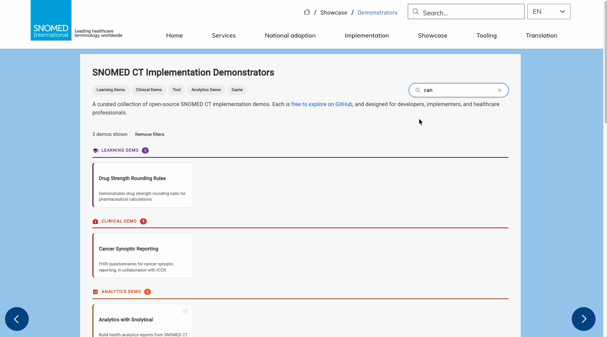
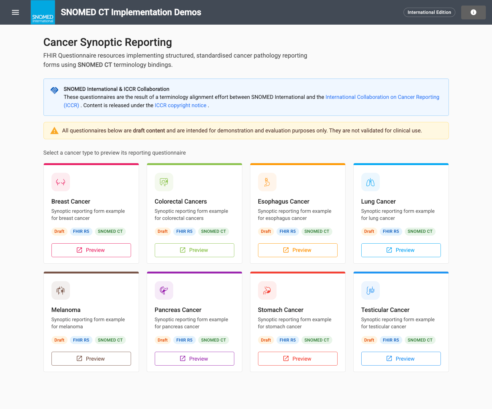
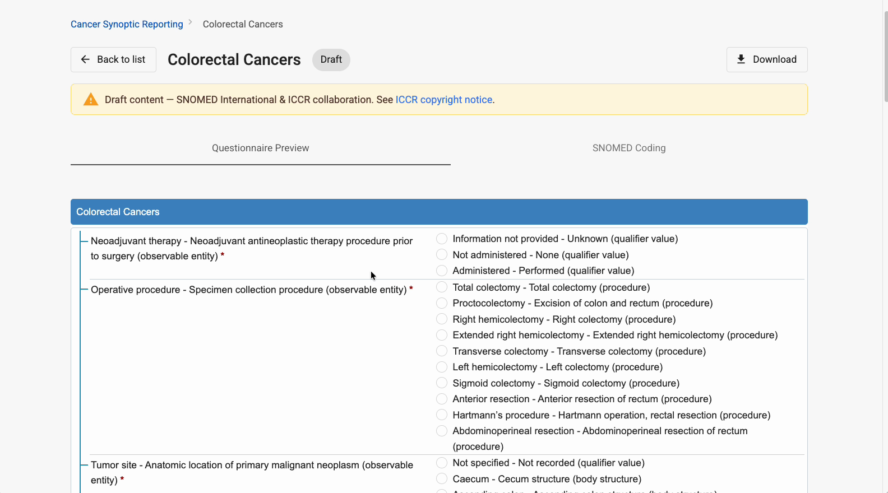
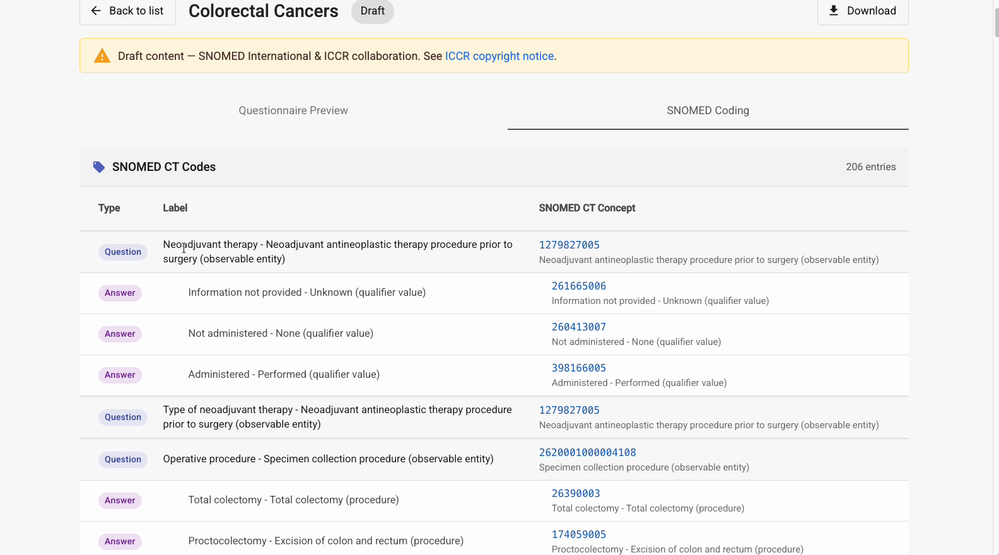
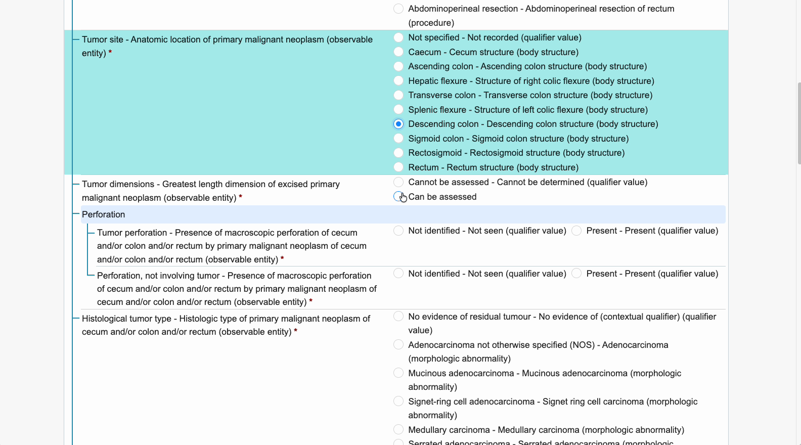
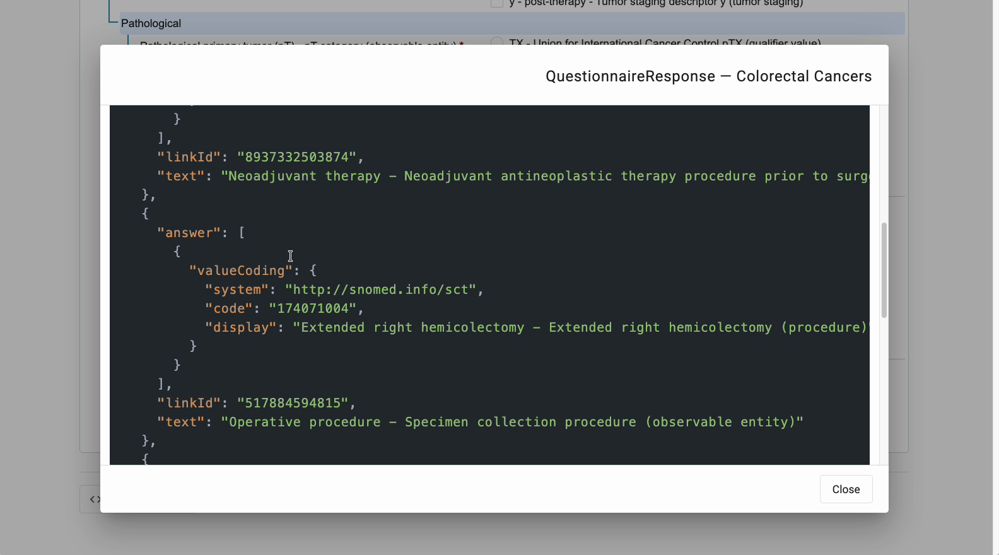
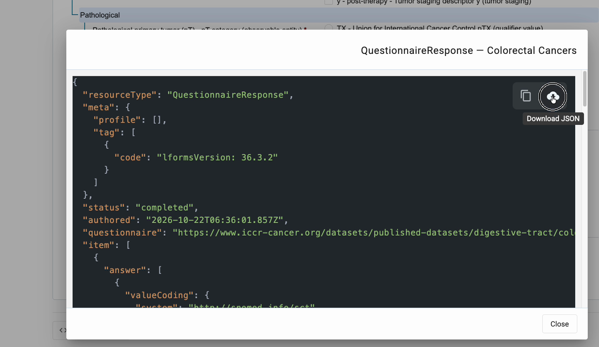

# Cancer Synoptic Reporting

The **Cancer Synoptic Reporting** demonstrator shows how **SNOMED CT** can represent the information in structured, standardised cancer pathology reports, using **HL7 FHIR** Questionnaires. It is one of the open-source [SNOMED CT Implementation Demonstrators](https://implementation.snomed.org/showcase/demonstrators), and it supplements the [SNOMED CT Implementation Guide for Cancer Synoptic Reporting](https://docs.snomed.org/implementation-guides/cancer-synoptic-reporting-implementation-guide).

The questionnaires are the result of a terminology alignment effort between SNOMED International and the [International Collaboration on Cancer Reporting (ICCR)](https://www.iccr-cancer.org/). They were developed with the SNOMED International clinical reference group for pathology and are derived from the ICCR data sets. Content is released under the ICCR copyright notice, linked from the demonstrator.

**Try it here:** [https://ihtsdo.github.io/sct-implementation-demonstrator/#/cancer-reporting](https://ihtsdo.github.io/sct-implementation-demonstrator/#/cancer-reporting)

## Watch the video


A short walkthrough of the demonstrator: the background to cancer synoptic reporting, finding the demonstrator, the questionnaire preview, the SNOMED CT bindings and the FHIR QuestionnaireResponse.



All questionnaires in this demonstrator are **draft content**. They are intended for demonstration and evaluation purposes only and are not validated for clinical use.


## Background

Pathology reports for cancer diagnosis and prognosis are increasingly structured in synoptic form, following data sets from bodies such as the College of American Pathologists (CAP), the Royal College of Pathologists (RCPath) and the ICCR. To reach the electronic health record and cancer registries, and to support research, these data elements need to be machine readable as well as human readable.

Before 2020, SNOMED CT content for cancer synoptic reporting was limited. The SNOMED International Cancer Synoptic Reporting project group has since developed content for the required data elements of adult and pediatric solid tumors, mostly as observable entities. The [Implementation Guide](https://docs.snomed.org/implementation-guides/cancer-synoptic-reporting-implementation-guide) explains how to use it. This demonstrator shows the result in practice.

## What you can do

| Goal                                                      | Where in the tool                                   | What you see                                                          |
| --------------------------------------------------------- | --------------------------------------------------- | --------------------------------------------------------------------- |
| Choose a cancer type                                      | The cards on the **Cancer Synoptic Reporting** page | One example form per cancer type                                      |
| Fill in a synoptic report                                 | **Questionnaire Preview** tab                       | The FHIR Questionnaire rendered as an interactive form                |
| See the SNOMED CT concept behind each question and answer | **SNOMED Coding** tab                               | Every question and answer option with its SNOMED CT concept           |
| See the coded result                                      | **Show response** at the bottom of the form         | The FHIR `QuestionnaireResponse`, with each answer coded in SNOMED CT |
| Reuse the result                                          | The copy and download icons in the response         | The response on the clipboard or as a JSON file                       |

## Before you start

* **Find the tool.** Open the [SNOMED CT Implementation Demonstrators](https://implementation.snomed.org/showcase/demonstrators) page and select **Cancer Synoptic Reporting** under **Clinical demos**, or type `cancer` in the search box.
* **Check the edition.** The top bar shows the edition the tool uses, for example **International Edition**.
* **Read the guide.** The [Implementation Guide](https://docs.snomed.org/implementation-guides/cancer-synoptic-reporting-implementation-guide) explains the content, the terminology binding principles and how the FHIR Questionnaires are built.

<figure><figcaption>
Search for cancer to find the demonstrator.
</figcaption></figure>

## Choose a cancer type

The **Cancer Synoptic Reporting** page lists one example reporting form for each cancer type:

* Breast cancer
* Colorectal cancers
* Esophagus cancer
* Lung cancer
* Melanoma
* Pancreas cancer
* Stomach cancer
* Testicular cancer

Each card is tagged **Draft**, **FHIR R5** and **SNOMED CT**. Select **Preview** to open the form.

<figure><figcaption>
Select a cancer type to preview its reporting questionnaire.
</figcaption></figure>

## Fill in a synoptic report



### Preview the questionnaire

The **Questionnaire Preview** tab renders the FHIR Questionnaire as a form. In the colorectal cancers example, the questions include **Neoadjuvant therapy**, **Operative procedure**, **Tumor site**, **Tumor dimensions** and **Histological tumor type**, each with its own answer options. Required questions are marked with an asterisk (\*).

Each label shows the ICCR data element name followed by the SNOMED CT term, for example _Operative procedure - Specimen collection procedure (observable entity)_.

<figure><figcaption>
The colorectal cancers questionnaire.
</figcaption></figure>



### See the SNOMED CT bindings

Open the **SNOMED Coding** tab. It lists every entry in the form, marked **Question** or **Answer**, with its SNOMED CT concept. The colorectal cancers form has 206 coded entries. For example:

| Type     | Label                        | SNOMED CT concept                                                                                  |
| -------- | ---------------------------- | -------------------------------------------------------------------------------------------------- |
| Question | Neoadjuvant therapy          | `1279827005` \|Neoadjuvant antineoplastic therapy procedure prior to surgery (observable entity)\| |
| Answer   | Information not provided     | `261665006` \|Unknown (qualifier value)\|                                                          |
| Answer   | Extended right hemicolectomy | `174071004` \|Extended right hemicolectomy (procedure)\|                                           |
| Answer   | Caecum                       | `32713005` \|Cecum structure (body structure)\|                                                    |

Questions are mostly bound to **observable entity** concepts. Answers come from the qualifier value, procedure, body structure and morphologic abnormality hierarchies.

<figure><figcaption>
Every question and answer option is bound to SNOMED CT.
</figcaption></figure>



### Complete the form

Return to **Questionnaire Preview** and select an answer for each question. The question you are answering is highlighted. Some answers open follow-up questions. For example, **Tumor dimensions** - **Can be assessed** asks for the maximum, second greatest and smallest tumor dimensions in mm.

<figure><figcaption>
Select an answer for each question.
</figcaption></figure>



### Show the response

Scroll to the bottom of the form and select **Show response**. The demonstrator generates a FHIR `QuestionnaireResponse`, a separate FHIR resource. Each answer is stored as a `valueCoding` with:

* `system`: `http://snomed.info/sct`
* `code`: the SNOMED CT concept ID, for example `174071004`
* `display`: the answer label and SNOMED CT term

The coding sits next to the `linkId` and `text` of the question it answers.

<figure><figcaption>
Each answer is coded in SNOMED CT.
</figcaption></figure>



### Copy or download the response

Use the icons at the top right of the response to **Copy to clipboard** or **Download JSON**.

<figure><figcaption>
Copy the response or download it as JSON.
</figcaption></figure>




**Why this matters.** Because every answer is a SNOMED CT concept, the completed report can be shared with cancer registries and other organizations and reused for analytics and research, without relying on free-text interpretation.


## Tips

* **Looking for a concept ID?** Use the **SNOMED Coding** tab rather than the form. It lists the concept for every question and answer option.
* **Comparing cancer types?** Select **Back to list** and open another card. All the forms follow the same pattern.
* **Building your own forms?** The [Implementation Guide](https://docs.snomed.org/implementation-guides/cancer-synoptic-reporting-implementation-guide) describes the terminology binding principles and the FHIR Questionnaire approach used here.

## Related resources

* [SNOMED CT Implementation Guide for Cancer Synoptic Reporting](https://docs.snomed.org/implementation-guides/cancer-synoptic-reporting-implementation-guide)
* [International Collaboration on Cancer Reporting (ICCR)](https://www.iccr-cancer.org/)
* [SNOMED CT Implementation Demonstrators](https://implementation.snomed.org/showcase/demonstrators)
* [FHIR Questionnaire resource (HL7)](https://hl7.org/fhir/questionnaire.html)
* [FHIR QuestionnaireResponse resource (HL7)](https://hl7.org/fhir/questionnaireresponse.html)

_SNOMED CT Implementation Demos - Cancer Synoptic Reporting_\
[https://ihtsdo.github.io/sct-implementation-demonstrator/#/cancer-reporting](https://ihtsdo.github.io/sct-implementation-demonstrator/#/cancer-reporting)
