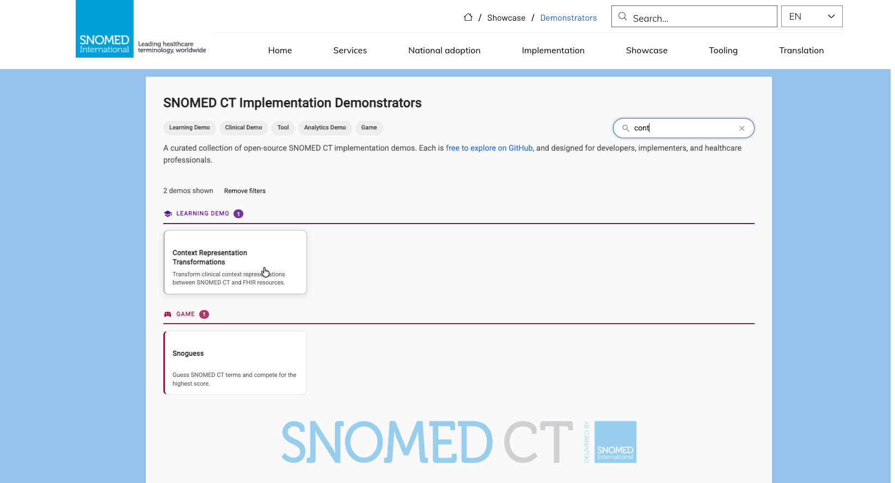
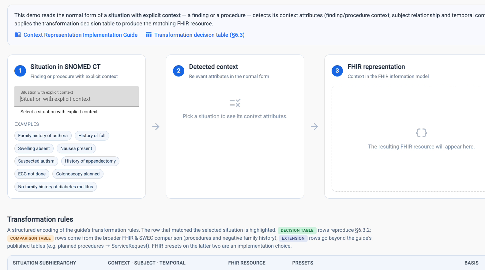
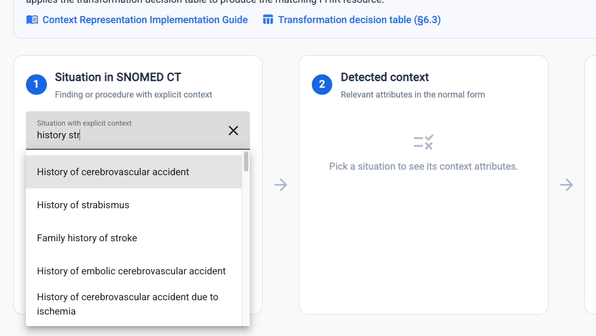
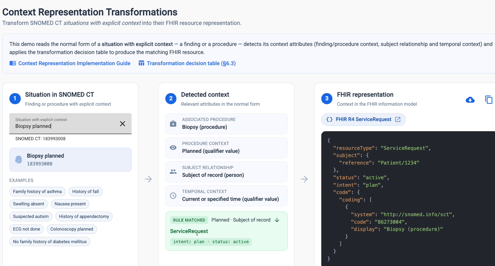
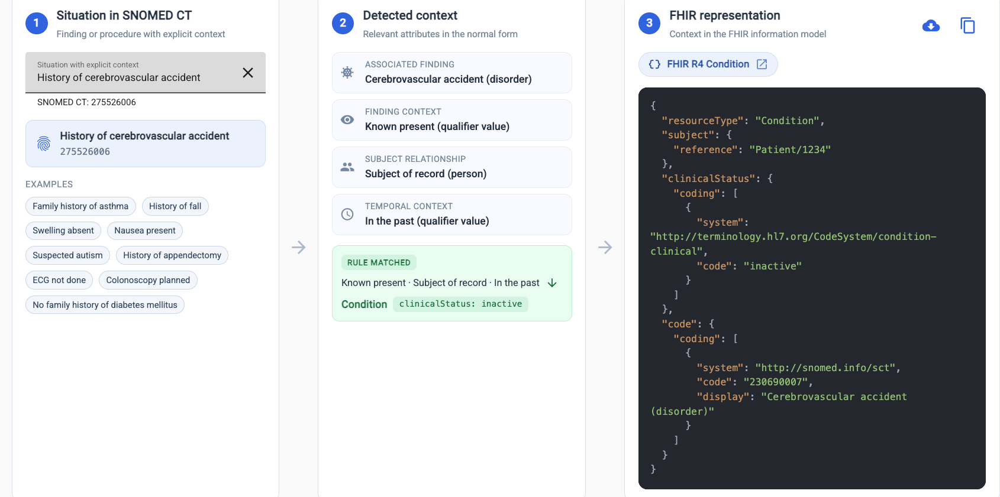

# Context Representation Transformations

The **Context Representation Transformations** demonstrator shows how a SNOMED CT concept from the _Situation with explicit context_ hierarchy can be transformed into its FHIR resource representation.

You select a situation, and the demonstrator:

1. reads the concept's normal form,
2. detects its context attributes (finding or procedure context, subject relationship and temporal context), and
3. applies the [transformation decision table](https://docs.snomed.org/implementation-guides/context-representation-implementation-guide/6-technical-application) from the [Context Representation Implementation Guide](https://docs.snomed.org/implementation-guides/context-representation-implementation-guide) to produce the matching FHIR R4 resource.

**Try it here:** [https://ihtsdo.github.io/sct-implementation-demonstrator/#/context](https://ihtsdo.github.io/sct-implementation-demonstrator/#/context)

## Watch the video


A short walkthrough of the Context Representation Transformations demonstrator.




The demonstrator is also listed under **Learning Demos** in the [SNOMED CT Implementation Demonstrators](https://implementation.snomed.org/showcase/demonstrators).


## Who is it for?

* **Implementers and developers** who have to exchange SNOMED CT situation concepts in FHIR.
* **Terminologists and clinical informaticists** who want to see how context in the terminology maps to context in the information model.
* **Educators** explaining the Context Representation Implementation Guide.

## Background

The _Situation with explicit context_ hierarchy adds context to clinical findings and procedures. For example, it can record that a disorder is absent, that a procedure is planned, or that a finding relates to a family member rather than the patient.


**Recommended practice:** record the clinical finding or procedure itself, using concepts from those hierarchies. Then represent the context with the information model, for example in FHIR elements such as `clinicalStatus`, `intent` or `status`. This is described in the [Context Representation Implementation Guide](https://docs.snomed.org/implementation-guides/context-representation-implementation-guide).

Situation concepts exist for only a limited set of combinations. Pre-coordinating every finding and procedure with every context would cause a combinatorial explosion of the terminology. The demonstrator is for cases where implementers do need to use situation concepts and want to know how to represent them in FHIR.


## Finding the demonstrator

<figure><figcaption><p>Search the demonstrators page for "context" to find the card under Learning Demo.</p></figcaption></figure>

1. Go to [implementation.snomed.org/showcase/demonstrators](https://implementation.snomed.org/showcase/demonstrators).
2. Type **context** in the **Search demos** box, or scroll to **Learning Demo**.
3. Select **Context Representation Transformations**.

## The screen at a glance

<figure><figcaption><p>The three panels, the links to the guide, and the Transformation rules table.</p></figcaption></figure>

| Area                         | What it shows                                                                                                          |
| ---------------------------- | ---------------------------------------------------------------------------------------------------------------------- |
| **1 Situation in SNOMED CT** | A search field for concepts in the _Situation with explicit context_ hierarchy, plus example chips you can click.      |
| **2 Detected context**       | The context attributes read from the selected concept's normal form, and the transformation rule that matched.         |
| **3 FHIR representation**    | The resulting FHIR R4 resource as JSON, with a link to the resource specification and buttons to download or copy it.  |
| **Transformation rules**     | A structured encoding of the guide's transformation rules. The row that matched the selected situation is highlighted. |

The links at the top of the page open the [**Context Representation Implementation Guide**](https://docs.snomed.org/implementation-guides/context-representation-implementation-guide) and the [**Transformation decision table (§6.3)**](https://docs.snomed.org/implementation-guides/context-representation-implementation-guide/6-technical-application).

## Using the demonstrator



### Select a situation

In panel **1**, start typing in the **Situation with explicit context** field. Matching concepts appear in a list as you type. Select one to load it.

You can also click one of the **Examples** chips, such as _Family history of asthma_, _Swelling absent_, _Suspected autism_, _ECG not done_ or _Colonoscopy planned_.

<figure><figcaption><p>Search results appear as you type.</p></figcaption></figure>

The selected concept's preferred term and SNOMED CT identifier are then shown below the field.



### Review the detected context

Panel **2** lists the attributes found in the concept's normal form:

| Attribute                                          | Meaning                                                                           |
| -------------------------------------------------- | --------------------------------------------------------------------------------- |
| **Associated finding** or **Associated procedure** | The underlying clinical finding or procedure.                                     |
| **Finding context** or **Procedure context**       | For example _Known present_, _Known absent_, _Planned_ or _Not done_.             |
| **Subject relationship**                           | Who the information is about, for example _Subject of record_ or a family member. |
| **Temporal context**                               | When it applies, for example _Current or specified time_ or _In the past_.        |

Below the attributes, the green **Rule matched** box shows which rule applied (for example _Planned · Subject of record_), the target FHIR resource, and any preset values. Click the arrow to jump to that rule in the **Transformation rules** table.



### Use the FHIR resource

Panel **3** shows the resulting FHIR R4 resource. In the resource:

* The `code` is the **underlying finding or procedure**, not the situation concept.
* The context is carried by FHIR elements such as `clinicalStatus`, `intent` and `status`.

From panel 3 you can:

* select the resource-type link (for example **FHIR R4 ServiceRequest**) to open its HL7 FHIR specification,
* use the **download** icon to save the JSON, and
* use the **copy** icon to copy the JSON to the clipboard.


The `subject` reference (`Patient/1234`) is a placeholder for the patient.




## Worked examples



**Situation:** Biopsy planned, `183993008`

<figure><figcaption><p>Biopsy planned becomes a FHIR ServiceRequest.</p></figcaption></figure>

| Detected context     | Value                                       |
| -------------------- | ------------------------------------------- |
| Associated procedure | Biopsy (procedure)                          |
| Procedure context    | Planned (qualifier value)                   |
| Subject relationship | Subject of record (person)                  |
| Temporal context     | Current or specified time (qualifier value) |

**Rule matched:** Planned · Subject of record → **ServiceRequest**, `intent: plan`, `status: active`

```json
{
  "resourceType": "ServiceRequest",
  "subject": { "reference": "Patient/1234" },
  "status": "active",
  "intent": "plan",
  "code": {
    "coding": [
      {
        "system": "http://snomed.info/sct",
        "code": "86273004",
        "display": "Biopsy (procedure)"
      }
    ]
  }
}
```

The situation concept is replaced by the procedure **Biopsy** (`86273004`). The "planned" context moves into `intent` and `status`.



**Situation:** History of cerebrovascular accident, `275526006`

<figure><figcaption><p>History of cerebrovascular accident becomes a FHIR Condition.</p></figcaption></figure>

| Detected context     | Value                               |
| -------------------- | ----------------------------------- |
| Associated finding   | Cerebrovascular accident (disorder) |
| Finding context      | Known present (qualifier value)     |
| Subject relationship | Subject of record (person)          |
| Temporal context     | In the past (qualifier value)       |

**Rule matched:** Known present · Subject of record · In the past → **Condition**, `clinicalStatus: inactive`

```json
{
  "resourceType": "Condition",
  "subject": { "reference": "Patient/1234" },
  "clinicalStatus": {
    "coding": [
      {
        "system": "http://terminology.hl7.org/CodeSystem/condition-clinical",
        "code": "inactive"
      }
    ]
  },
  "code": {
    "coding": [
      {
        "system": "http://snomed.info/sct",
        "code": "230690007",
        "display": "Cerebrovascular accident (disorder)"
      }
    ]
  }
}
```

The code is the disorder itself, **Cerebrovascular accident** (`230690007`). The "in the past" context is expressed as `clinicalStatus` _inactive_.



## Understanding the Transformation rules table

Below the panels, the **Transformation rules** table lists every rule the demonstrator applies. Its columns are **Situation subhierarchy**, **Context · Subject · Temporal**, **FHIR resource**, **Presets** and **Basis**. When you select a situation, the matching row is highlighted.

The **Basis** column shows where each rule comes from:

| Basis                                                   | Meaning                                                                                                                                                                                                          |
| ------------------------------------------------------- | ---------------------------------------------------------------------------------------------------------------------------------------------------------------------------------------------------------------- |
| <mark style="color:green;">**Decision table**</mark>    | Reproduces the [decision table](https://docs.snomed.org/implementation-guides/context-representation-implementation-guide/6-technical-application) in §6.3.2 of the Context Representation Implementation Guide. |
| <mark style="color:orange;">**Comparison table**</mark> | Taken from the guide's broader FHIR and SWEC comparison, covering procedures and negative family history.                                                                                                        |
| **Extension**                                           | Goes beyond the guide's published tables, for example planned procedures → ServiceRequest.                                                                                                                       |


The FHIR presets on **Comparison table** and **Extension** rows are an implementation choice made for this demonstrator. They are not normative guidance. For example, _Biopsy planned_ matches an extension rule.


## Tips

* Try examples with different contexts to see how the same pattern leads to different resources. _Swelling absent_ and _Nausea present_ differ only in finding context. _Family history of asthma_ and _History of fall_ differ in subject relationship.
* If no rule matches a situation, the transformation tables don't cover that combination of context values.
* The demonstrator is for learning and exploration. Validate any transformation logic against the Context Representation Implementation Guide and your own implementation requirements before using it in production.

## Related resources

* [Context Representation Transformations demonstrator](https://ihtsdo.github.io/sct-implementation-demonstrator/#/context)
* [SNOMED CT Implementation Demonstrators](https://implementation.snomed.org/showcase/demonstrators)
* [Context Representation Implementation Guide](https://docs.snomed.org/implementation-guides/context-representation-implementation-guide)
* [Transformation decision table (§6.3)](https://docs.snomed.org/implementation-guides/context-representation-implementation-guide/6-technical-application)
* [HL7 FHIR R4 Condition](https://hl7.org/fhir/R4/condition.html) and [HL7 FHIR R4 ServiceRequest](https://hl7.org/fhir/R4/servicerequest.html)

_SNOMED CT Implementation Demos - Context Representation Transformations_\
[https://ihtsdo.github.io/sct-implementation-demonstrator/#/context](https://ihtsdo.github.io/sct-implementation-demonstrator/#/context)
