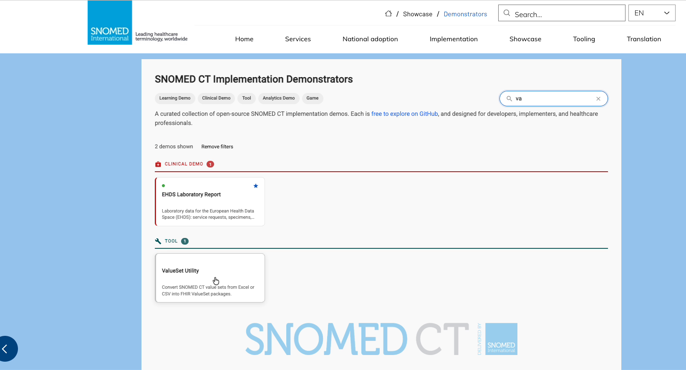
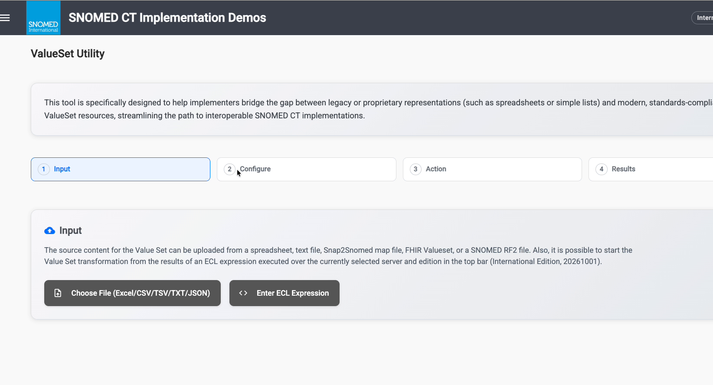
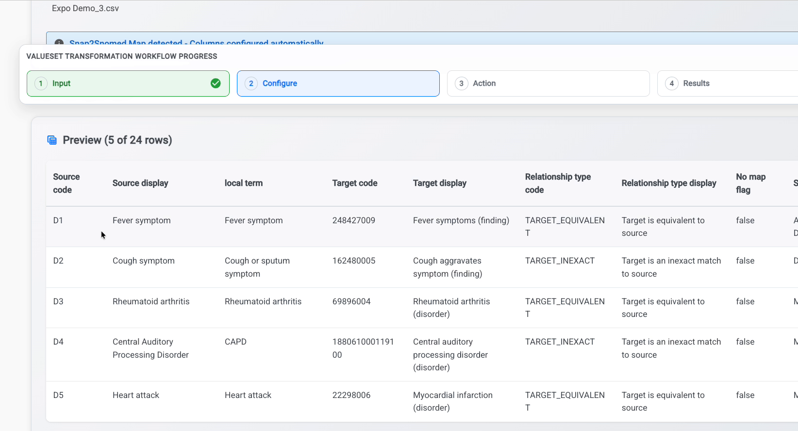
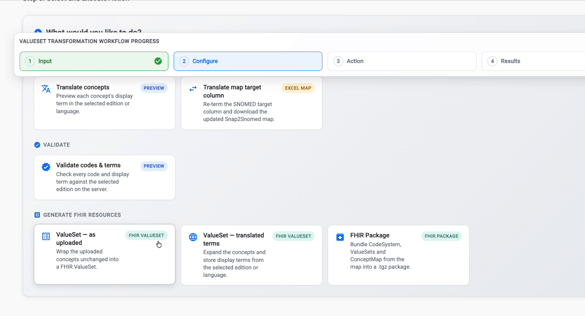
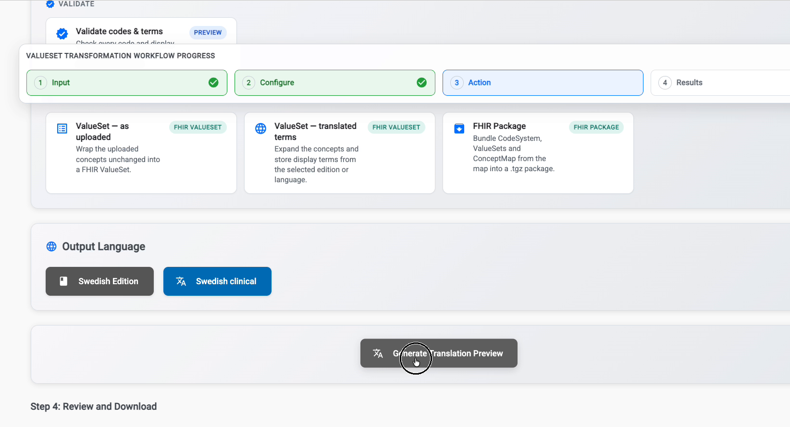
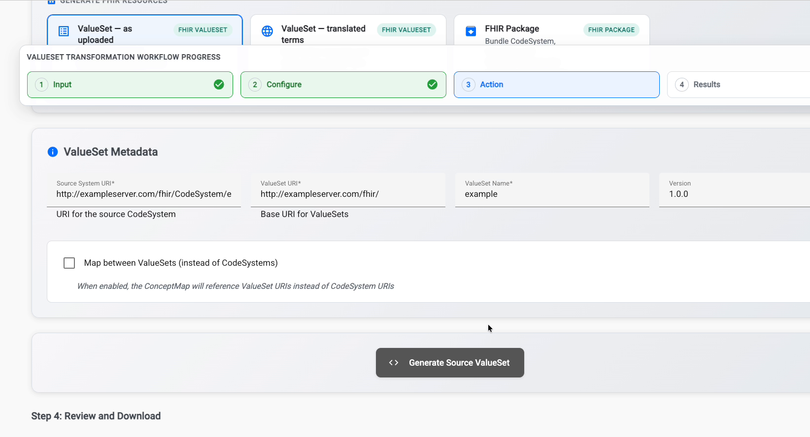
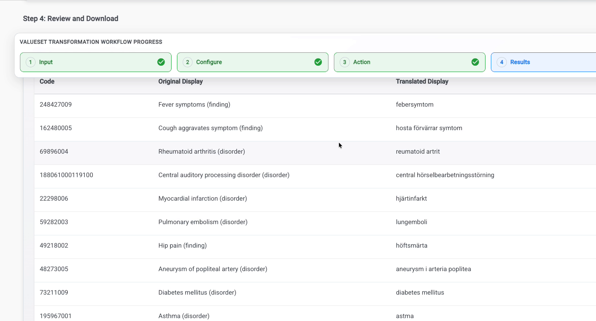
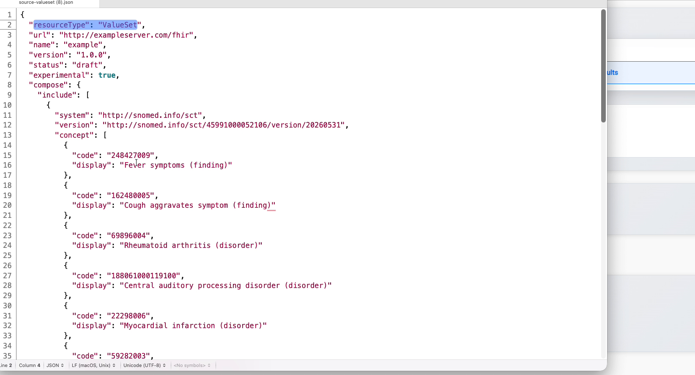

# ValueSet Utility

The **ValueSet Utility** helps implementers bridge the gap between legacy or proprietary code lists, such as spreadsheets, simple lists or local mapping files, and modern, standards-compliant **FHIR ValueSet** resources. It is one of the open-source [SNOMED CT Implementation Demonstrators](https://implementation.snomed.org/showcase/demonstrators).

**Try it here:** [https://ihtsdo.github.io/sct-implementation-demonstrator/#/valueset-translator](https://ihtsdo.github.io/sct-implementation-demonstrator/#/valueset-translator)

## Watch the 2-minute video


A 2-minute walkthrough of the ValueSet Utility.



The ValueSet Utility is a **demonstrator**. Use it to explore and prototype. Review and validate any generated resources before you use them in production.


## What you can do

| Goal | Action in the tool | Output |
| --- | --- | --- |
| See your concepts in another edition or language | **Translate concepts** | On-screen preview, downloadable as Excel |
| Re-term the SNOMED CT target column of a map | **Translate map target column** | Updated Snap2Snomed map (Excel) |
| Check codes and display terms | **Validate codes & terms** | On-screen preview |
| Wrap your concepts in a FHIR ValueSet | **ValueSet – as uploaded** | FHIR ValueSet (JSON) |
| Build a ValueSet with translated display terms | **ValueSet – translated terms** | FHIR ValueSet (JSON) |
| Bundle everything from a map | **FHIR Package** | `.tgz` package with CodeSystem, ValueSets and ConceptMap |

## Before you start

* **Find the tool.** Open the [SNOMED CT Implementation Demonstrators](https://implementation.snomed.org/showcase/demonstrators) page, filter on **Tool** or search for "ValueSet", and select **ValueSet Utility**.
* **Check the edition.** The top bar shows the server and edition the tool works against, for example *International Edition, 20261001*. ECL queries, validation and the default terms all use this edition.
* **Prepare your content.** Use one of these:
  * a spreadsheet (Excel, CSV or TSV) or a text file with your codes and terms
  * a **Snap2Snomed** map export
  * an existing **FHIR ValueSet** (JSON)
  * a **SNOMED CT RF2** file
  * or no file at all: you can start from an **ECL** (SNOMED Expression Constraint Language) query instead

<figure><figcaption><p>Find the ValueSet Utility among the Implementation Demonstrators.</p></figcaption></figure>

## The four-step workflow

The tool guides you through **Input → Configure → Action → Results**. A progress bar at the top of the page shows where you are. Completed steps get a green tick.

<figure><figcaption><p>The ValueSet Utility start page.</p></figcaption></figure>



### Input: load your content

Choose one of the two buttons on the **Input** card:

* **Choose File (Excel/CSV/TSV/TXT/JSON)** uploads a spreadsheet, text file, Snap2Snomed map, FHIR ValueSet or RF2 file.
* **Enter ECL Expression** runs an ECL query against the edition selected in the top bar and uses the results as your source content.

The name of the loaded file appears below the buttons. If the tool recognises a **Snap2Snomed** map, it shows *"Snap2Snomed Map detected – Columns configured automatically"*.



### Configure: check your data

The **Preview** table shows the first rows of your content, for example *5 of 24 rows*. Select **Load more** to see more.

For a Snap2Snomed map, the preview includes the source code and display, the local term, the SNOMED CT target code and display, the relationship type, the no-map flag and the map status.

<figure><figcaption><p>Preview of an uploaded Snap2Snomed map.</p></figcaption></figure>


Check that the codes and terms sit in the expected columns before you continue. Snap2Snomed maps are configured automatically.




### Action: choose what to produce

Under **What would you like to do?**, pick a goal. Each card shows what it produces:

* **Translate / re-term**
  * **Translate concepts** (*Preview*) shows each concept's display term in the selected edition or language.
  * **Translate map target column** (*Excel map*) re-terms the SNOMED CT target column and downloads the updated Snap2Snomed map.
* **Validate**
  * **Validate codes & terms** (*Preview*) checks every code and display term against the selected edition on the server.
* **Generate FHIR resources**
  * **ValueSet – as uploaded** (*FHIR ValueSet*) wraps the uploaded concepts, unchanged, into a FHIR ValueSet.
  * **ValueSet – translated terms** (*FHIR ValueSet*) expands the concepts and stores display terms from the selected edition or language.
  * **FHIR Package** (*FHIR package*) bundles a CodeSystem, ValueSets and a ConceptMap from the map into a `.tgz` package.

<figure><figcaption><p>Choose an action.</p></figcaption></figure>

Depending on the action, you then set one or both of the following.

**Output language**, for translation actions:

1. Select the edition button, for example **Swedish Edition**, and choose the edition from the list.
2. The tool selects a matching language context, for example **Swedish clinical**. To change it, select the language button and choose from **Language Codes** or **Language Refsets**.
3. Select **Generate Translation Preview**.

<figure><figcaption><p>Choose the output edition and language.</p></figcaption></figure>

**ValueSet metadata**, for FHIR resource actions:

| Field | What to enter |
| --- | --- |
| **Source System URI** \* | URI for the source (local) CodeSystem |
| **ValueSet URI** \* | Base URI for the generated ValueSets |
| **ValueSet Name** \* | A name for the ValueSet. It is also used in the file names. |
| **Version** | Version of the resources (default `1.0.0`) |
| **Map between ValueSets** | When ticked, the ConceptMap references ValueSet URIs instead of CodeSystem URIs |

\* Required.

Then select the generate button, for example **Generate Source ValueSet**, **Generate Target ValueSet** or **Generate FHIR Package**.

<figure><figcaption><p>Add ValueSet metadata, then generate.</p></figcaption></figure>



### Results: review and download

**Step 4: Review and Download** shows the result.

* **Translation preview:** a table of **Code**, **Original Display** and **Translated Display**.
* **Download options:** depending on the action, **Download Source ValueSet**, **Download Target ValueSet** or **Download as Excel**.

<figure><figcaption><p>Translation preview into Swedish.</p></figcaption></figure>

A downloaded ValueSet is a standard FHIR `ValueSet` resource. Its `compose.include` lists the SNOMED CT system (`http://snomed.info/sct`), the edition version and each concept's `code` and `display`.

<figure><figcaption><p>A generated FHIR ValueSet.</p></figcaption></figure>



## FHIR package contents

**FHIR Package** produces a `.tgz` file. Unpacked, it contains the following, with file names based on the ValueSet name you entered (here *ExampleSet*):

```
package/
├── package.json
├── CodeSystem/
│   └── ExampleSetCodeSystem.json        # your local codes as a CodeSystem
├── ValueSet/
│   ├── ExampleSetValueSet.json          # ValueSet of the local codes
│   └── ExampleSetSnomedValueSet.json    # ValueSet of the SNOMED CT targets
└── ConceptMap/
    └── ExampleSetToSnomedMap.json       # map from local codes to SNOMED CT
```

## Example: translate a Snap2Snomed map into Swedish

1. Under **Input**, choose your Snap2Snomed map export. The tool detects it and configures the columns.
2. Check the **Preview**.
3. Under **Action**, select **Translate concepts**.
4. Set **Output Language** to **Swedish Edition**. *Swedish clinical* is selected automatically.
5. Select **Generate Translation Preview**. Each concept now shows its Swedish term next to the original.
6. Select **Download as Excel** for a simple list. Or scroll up, choose **ValueSet – translated terms**, fill in the metadata and generate a FHIR ValueSet.

## Tips and troubleshooting


**Generate button is greyed out?** Fill in all required metadata fields (marked \*).


* **Results look like the wrong edition?** Check the edition in the top bar before you run ECL queries or validation.
* **Terms didn't change after translating?** Make sure the language context, for example *Swedish clinical*, has terms for your concepts. Concepts without a translation in that language may keep their original display.
* **Starting from scratch?** Use **Enter ECL Expression** to build the source list directly from SNOMED CT, for example all descendants of a concept.
* **Use your own URIs.** Replace the example URIs (such as `http://example.org/fhir/...`) with ones that belong to your organisation before you publish any resources.

## Related resources

* [SNOMED CT Implementation Demonstrators](https://implementation.snomed.org/showcase/demonstrators)
* [Snap2Snomed](https://snap.snomedtools.org/)
* [ECL - SNOMED Expression Constraint Language guide](https://docs.snomed.org/snomed-ct-specifications/snomed-ct-expression-constraint-language)
* [FHIR ValueSet resource (HL7)](https://hl7.org/fhir/valueset.html)

_SNOMED CT Implementation Demos - ValueSet Utility_\
[https://ihtsdo.github.io/sct-implementation-demonstrator/#/valueset-translator](https://ihtsdo.github.io/sct-implementation-demonstrator/#/valueset-translator)
